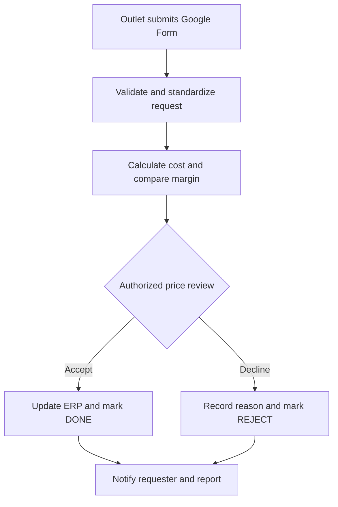

# Retail Price Change Control
### From scattered messages to a structured retail pricing workflow

A practical business analysis and process improvement project using **Google Forms, Google Sheets and Apps Script** to collect outlet price change requests, standardize invoice costs, compare supplier margins, and track decisions.

**Author:** Hareendranatha Muthukumarana  
**Focus:** Retail operations · Pricing controls · Workflow automation · Supplier analysis

> Portfolio reference implementation based on a retail business problem. All included records are synthetic. This package has local automated checks; deployment in Google Workspace and ERP integration have not been verified.

## The business problem
Goods receiving officers encounter supplier invoices with changes to cost, maximum retail price (MRP), or both. When requests arrive through phone calls and WhatsApp conversations, teams can miss requests, repeat calculations, duplicate work, and struggle to demonstrate when decisions were completed.

The business objective is to keep ERP price maintenance with authorized staff while giving outlets a consistent way to request adjustments.

## The solution
| Operational challenge | Workflow response |
|---|---|
| Requests lost in conversations | Form submission and centralized request register |
| Mixed invoice cost formats | Explicit cost type and configurable tax rate |
| Repeated margin calculations | Automatic comparable cost, GP and GP% |
| Supplier margin difficult to remember | Item-level agreed margin lookup |
| Several price changers working together | Shared status and assigned owner |
| Requester unsure of outcome | Prefilled WhatsApp decision message |
| Limited management visibility | Branch, requester, supplier and category analysis |



## What this demonstrates
- **Business analysis:** problem definition, stakeholder roles and acceptance criteria.
- **Process design:** request capture, exception handling, decision ownership and closure.
- **Spreadsheet engineering:** tax normalization, margin lookup and date-filtered reporting.
- **Automation:** event-driven Apps Script, input checks and stable request identifiers.
- **Commercial awareness:** supplier margin exceptions and operational performance measures.

## Start here
1. Follow [the setup guide](docs/SETUP.md).
2. Review [the data dictionary](docs/DATA_DICTIONARY.md) and [formulas](docs/FORMULAS.md).
3. Paste [Code.gs](src/Code.gs) into the response spreadsheet's Apps Script project.
4. Use [synthetic examples](sample-data/requests.csv) to understand the calculations.
5. Review [controls and measurement](docs/CONTROLS_AND_KPIS.md) before operational use.

## Calculation example
With a **demonstration tax rate of 18%**, invoice cost 100 excluding VAT becomes 118. If MRP is 150, the retail spread is 32 and the retail spread percentage is 21.33%.

This project preserves the original operational definition `GP% = (MRP − VAT-inclusive cost) / MRP`. It is a **retail spread indicator**, not necessarily accounting gross margin. Finance should define a consistent tax basis for commercial agreements and financial reporting.

## Delivery boundaries
- This workflow records requests; it does **not** lock prices inside the ERP. ERP roles must enforce that control.
- WhatsApp links prepare a message; a person must review and send it. A link click does not prove delivery.
- DONE means the reviewer confirms the ERP update is complete. It is not an automated ERP verification.
- Google tools may permit operation without additional software spending under an existing account. Account limits, administration and maintenance still apply.
- Benefits are expected outcomes, **not measured savings**. No invented accuracy, savings or productivity claims are included.

## Repository contents
```text
src/Code.gs                 Form-submit handler and cost calculation
src/pricing.js              Pure calculation functions, shared with Code.gs
tests/pricing.test.js        Calculation and item-code checks
docs/                       Setup, formulas, controls and portfolio narrative
sample-data/                Synthetic requests and master data
```

Run local checks with `node --test tests/pricing.test.js`. No npm dependencies required.

## Roadmap
Documented future enhancements: protected decision interface, immutable external audit history, duplicate warnings, effective-dated supplier agreements, notifications with delivery evidence, and controlled ERP integration.

## References
- [Google Apps Script installable triggers](https://developers.google.com/apps-script/guides/triggers/installable)
- [Spreadsheet event objects](https://developers.google.com/apps-script/guides/triggers/events)
- [Google Sheets QUERY](https://support.google.com/docs/answer/3093343)

See [portfolio notes](docs/PORTFOLIO.md) for a repository description, topics and interview narrative.
